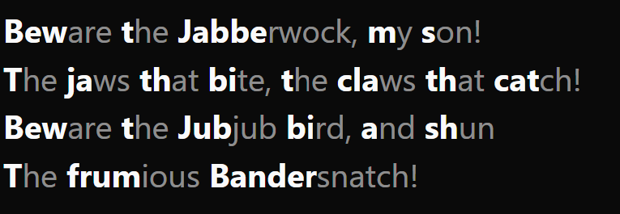
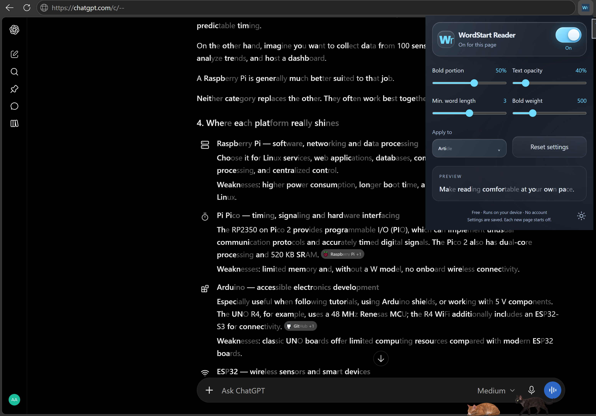

# WordStart Reader

A browser extension that helps you read walls of text by emphasizing the first letters of words to guide your eyes through text. Adjustable emphasis and lighter word endings let you find a reading style that feels easier to follow.

All reading features run on your device. No account, server, analytics, remote scripts, or runtime dependencies are required.

An example from Lewis Carroll's *Jabberwocky*:



Inspired by [Bionic Reading](https://bionic-reading.com/), [text-vide](https://github.com/Gumball12/text-vide), and [OpenBionic](https://github.com/qwerzl/OpenBionic). WordStart Reader is an independent implementation and is not affiliated with these projects.

## Screenshot



## Features

- Reading mode switch for the current page.
- Four sliders: bold portion, remaining text opacity, minimum word length, and font weight.
- Article/main content or whole-page scope.
- Live sample and formatted dropdown choices; interface labels stay plain.
- Muted-blue dark theme and near-white orange light theme.
- Local settings and theme storage.
- Wr toolbar icon: color when active, monochrome when inactive.
- Newly loaded page text is processed while reading mode is on.

## Install locally

1. Download and extract this repository, or clone it.
2. Open `chrome://extensions` or `edge://extensions`.
3. Enable **Developer mode**.
4. Select **Load unpacked** and choose this repository's `extension` folder.
5. Open an ordinary article, then open WordStart Reader from the extensions menu.
6. Turn on **Reading mode**. Turn it off to restore normal text.

After source updates, reload the extension on the extensions page and refresh the reading tab.

## Settings

| Setting | Range | Reset default |
| --- | --- | --- |
| Bold portion | 10–80% | 50% |
| Remaining text opacity | 30–100% | 40% |
| Minimum word length | 1–5 letters | 3 letters |
| Bold weight | 400, 500, 600, 700, 800 | 600 |
| Apply to | Article or Whole page | Article |

Font weights mean Normal (400), Medium (500), Semi-bold (600), Bold (700), and Extra bold (800). Results depend on the font. Opacity applies to the remaining letters of formatted words. Set it to 100% to disable dimming.

Saved reading preferences survive updates. **Reset settings** applies the defaults above. Theme selection is saved separately. Reading mode starts off on new pages and reloads. If Article finds no text, try Whole page.

## Privacy and permissions

See [PRIVACY.md](PRIVACY.md). The extension uses `activeTab` and `scripting` to process a page after you open the extension. `storage` saves preferences locally. There is no permanent permission to read all websites.

## Limitations

- Desktop Chrome and Edge only; not Kindle or standard mobile Chrome.
- Browser internal pages, extension stores, built-in PDF viewers, frames, and shadow DOM are not supported.
- Latin, Greek, and Cyrillic words are supported. Chinese and Japanese text is left unchanged.
- Words split across page elements are processed separately.
- Text fields, editable content, buttons, and code blocks are skipped.
- Some interactive sites depend on their text-node structure. Turn the mode off or refresh if a site behaves incorrectly.
- Improved reading speed or understanding is not guaranteed.

## Development and tests

The extension itself has no build step or package dependencies. Node.js 20 or later, Microsoft Edge, and Playwright are required only to run the development checks.

```sh
npm install
npm run check
npm test
```

The tests launch installed Microsoft Edge in headless mode. They check text preservation, toggle restoration, dynamic content, links, editable exclusions, four sliders, scope, reset defaults, themes, popup layout, and toolbar icon logic. Popup browser APIs are simulated; toolbar logic is checked separately. Load the extension manually for an installed-extension smoke test. The generated `popup-off.png` is ignored by Git.

## Repository structure

```text
extension/       Load this folder into Chrome or Edge
test.cjs         Development checks
package.json     Development dependency and commands
PRIVACY.md       Data handling description
```

## Publishing with GitHub Desktop

This folder intentionally has no `.git` directory. Initialize it as a repository with GitHub Desktop, review the initial files, make the first commit, and use **Publish repository**. Choose public or private visibility there. Nothing has been uploaded automatically.

## License

No open-source license has been selected yet. A public repository alone does not grant a general permission to reuse the code. Select and add a license before advertising the project as open source.
